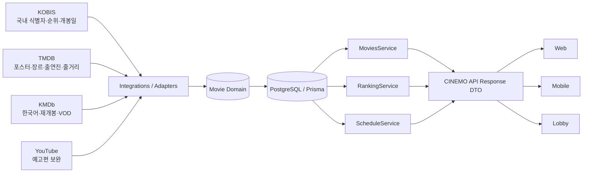
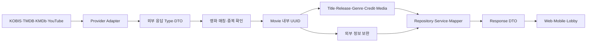
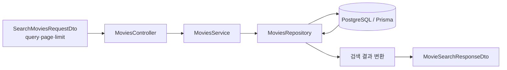
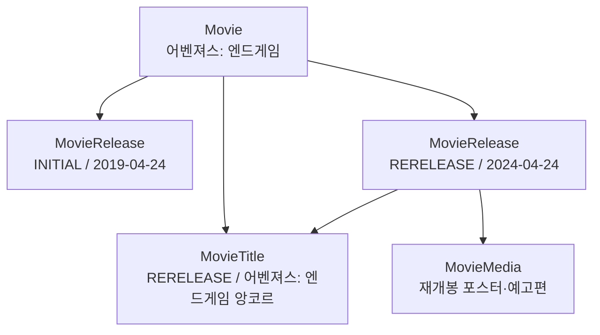
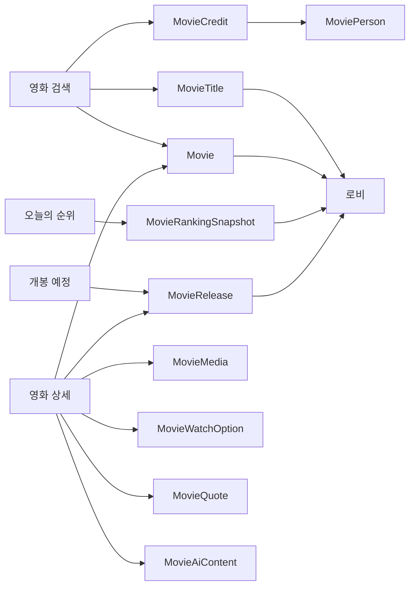

# CINEMO Movie 도메인

영화와 직접 관련된 데이터·외부 연동·API 흐름만 정리한 문서.

모델별 Prisma 코드와 필드 설명은 [Movie 모델 문서](./model.md)에서 확인.

## 먼저 이해할 개념: `Movie` 행

`Movie`는 영화 데이터 전체를 뜻하는 표현이 아니라, `movies` 테이블에 저장되는 영화 기본 행(row)이다.

영화 한 편을 CINEMO 내부에서 식별하기 위한 루트 데이터이며, 제목·개봉일·포스터·감독·배우·외부 Provider ID는 `movie.id`를 기준으로 별도 테이블에 연결한다.

현재 `Movie` 모델에 직접 저장하는 영화 자체 정보는 다음과 같다.

```prisma
model Movie {
  id                     String   @id
  productionCountryCodes String[] // 제작 국가 ISO 3166-1 alpha-2 코드
  createdAt              DateTime
  updatedAt              DateTime
}
```

`productionCountryCodes`는 제작 국가를 저장하는 필드이다. 예를 들어 일본 제작 영화는 `["JP"]`로 저장한다. 원어(`original_language`)나 개봉 국가(`MovieRelease.countryCode`)를 이 필드에 저장하지 않는다.

```text
Movie.productionCountryCodes
└── ["JP"]             제작 국가

MovieRelease.countryCode
└── "KR"               해당 개봉일의 국가
```

영화 제목·개봉일·포스터·감독·배우는 `Movie`에 직접 넣지 않고 각각의 관계 모델에 저장한다.

```ts
const movie = await tx.movie.create({
  data: {},
});
```

위 코드는 `movies` 테이블에 영화 기본 행을 만들고, Prisma가 내부 UUID인 `movie.id`를 생성하는 코드이다. `Movie`에 제목이나 포스터가 직접 들어가는 것이 아니라, 생성된 `movie.id`를 이용해 관련 데이터를 연결한다.

```text
movies 행 1개
└─ movie.id
   ├─ movie_titles              제목
   ├─ movie_releases            개봉·재개봉일
   ├─ movie_media               포스터·배경·예고편
   ├─ movie_credits             감독·배우
   ├─ movie_genres              장르
   └─ movie_provider_links      TMDB·KMDb·KOBIS 외부 ID
```

따라서 `data: {}`는 관련 정보가 없는 빈 영화를 남긴다는 뜻이 아니다. `movies`에 루트 행을 만든 뒤, 같은 트랜잭션에서 제목·개봉일·미디어·외부 Provider 연결을 `movie.id`로 저장하는 시작 단계이다.

## 제작 국가 데이터가 들어오는 경로

`Movie.productionCountryCodes`는 KOBIS와 TMDB가 각각 보완할 수 있는 공통 영화 데이터이다. 두 provider의 응답 구조가 다르므로 각 수집 경로에서 내부 저장 형식으로 변환한다.

```text
KOBIS 원본 응답
  → KobisMovieImportInput
  → KobisMovieImportMapper
  → MoviesRepository
  → Movie.productionCountryCodes
```

```text
TMDB 상세 응답
  → TmdbMovieEnrichmentService
  → Movie.productionCountryCodes
```

각 코드의 책임:

- `KobisMovieImportInput`: KOBIS 원본 데이터를 내부 저장 Service로 전달하는 입력 타입
- `KobisMovieImportMapper`: KOBIS의 국가명(`일본`)을 ISO 코드(`JP`)로 변환
- `TmdbMovieEnrichmentService`: TMDB의 `production_countries[].iso_3166_1` 값을 제작 국가로 저장

둘은 같은 필드를 중복해서 만드는 것이 아니라, 서로 다른 provider 수집 경로가 하나의 `Movie` 데이터를 보완하는 구조이다.

```text
KOBIS: ["JP"]
TMDB:  ["JP", "US"]
최종:  ["JP", "US"]
```

provider 보완 시 기존 국가 배열을 무조건 덮어쓰지 않고, 중복을 제거한 뒤 합치는 방식이 안전하다.

## `Input` 타입 구분

이름에 `Input`이 들어가도 모두 같은 종류의 입력은 아니다.

```text
KobisMovieImportInput
→ 애플리케이션 내부 입력 타입
→ KOBIS 데이터를 Repository로 전달

Prisma.MovieCreateInput
→ Prisma DB 작업 타입
→ prisma.movie.create({ data })의 data 구조
```

`KobisMovieImportInput`은 영화 제목·개봉일·제작 국가·감독·배우처럼 여러 테이블에 저장할 데이터를 한 번에 표현한다. Repository는 이 입력을 받아 각각의 Prisma 모델에 나누어 저장한다.

```text
KOBIS 응답
  → KobisMovieImportMapper
  → KobisMovieImportInput
  → MoviesRepository
  → Prisma create/update
```


### 영화 생성과 provider 보완

영화 루트 행을 만들 때 제작 국가를 이미 알고 있으면 생성 시 초기값으로 넣을 수 있다.

```ts
const data: Prisma.MovieCreateInput = {
  productionCountryCodes: ["JP"],
};

await prisma.movie.create({ data });
```

이 값은 모든 영화의 기본값이 아니라 해당 영화의 생성 시점 초기값이다. `@default([])`는 모든 새 `Movie`에 적용되는 Prisma 기본값이다.

현재 CINEMO의 일반 흐름은 다음과 같다.

```text
Movie 생성
  → productionCountryCodes = []

TMDB·KOBIS 보완
  → productionCountryCodes에 provider 국가 추가

최종 응답
  → 중복 제거된 제작 국가 배열 반환
```

provider 보완 결과는 기존 값을 덮어쓰지 않고 병합한다.

```text
초기값: ["JP"]
TMDB 보완: ["US"]
최종값: ["JP", "US"]
```


## TMDB 인기 영화 일괄 수집

영화 40개를 코드에 직접 작성하지 않는다. TMDB 인기 영화 목록을 페이지 단위로 가져와 자동 저장한다.

```text
TMDB 인기 영화 page 1
TMDB 인기 영화 page 2
        ↓
TmdbMovieBatchImportService
        ↓
TmdbMovieImportMapper
        ↓
MoviesRepository
        ↓
Movie 생성 또는 기존 Movie 연결
        ↓
TMDB 상세 정보·인물·미디어 보완
```

pageCount = 2이면 TMDB 인기 영화 1·2페이지를 조회하며, TMDB 응답 기준 최대 약 40편을 처리한다. 외부 ID가 이미 연결되어 있으면 새 Movie 레코드를 만들지 않고 기존 movieId를 재사용한다.

## Provider별 일괄 수집 가능 여부

현재 영화 조회와 외부 영화 일괄 수집은 목적이 다름.


| Provider | 일괄 수집 | 페이지 방식                | 수집 기준        |
| -------- | ----- | --------------------- | ------------ |
| TMDB     | 가능    | page = 1, 2...        | 인기 영화·현재 상영작 |
| KOBIS    | 가능    | curPage, itemPerPage  | 연도·개봉일 범위    |
| KMDb     | 가능    | startCount, listCount | 제목·연도·개봉일 범위 |


### TMDB

TMDB는 인기 영화·현재 상영작 목록을 page 단위로 제공함. page 1과 page 2를 조회하면 최대 약 40편을 자동 수집할 수 있음.

### KOBIS

KOBIS는 movie list API에서 curPage와 itemPerPage를 지원한다. 목록에서 movieCd를 받은 뒤 상세 API를 호출하여 기존 KobisMovieImportService.importMovie(movieCd) 흐름으로 저장한다.

KOBIS의 전체 영화 수집은 연도·개봉일 범위를 기준으로 나누어 실행하는 방식이 안전함. 조회용 검색어 없이 무제한으로 수집하지 않음.

### KMDb

KMDb는 startCount와 listCount를 사용하는 offset 기반 페이지 방식이다.

현재 KMDb 검색은 제목 query 중심이므로 빈 검색어로 전체 영화를 가져오는 방식은 사용하지 않는다. 연도나 개봉일 범위 같은 명확한 조건으로 나누어 수집해야 한다.

### 중복 방지

Provider별 BatchImportService가 각각 새 Movie를 무조건 만들면 같은 영화가 중복 저장된다. 외부 영화를 저장하기 전에 항상 MovieProviderLink와 기존 영화 후보를 확인한다.

### KOBIS 일별 박스오피스 재수집 시 TMDB 중복 연결 처리

KOBIS 일별 박스오피스를 다시 수집할 때 다음 오류가 발생할 수 있다.

```text
409 ConflictException
TMDB 영화가 다른 CINEMO 영화와 이미 연결되어 있습니다.
```

발생 원인은 KOBIS 영화가 먼저 새 `Movie`에 저장된 뒤, 같은 TMDB `externalId`가 이미 다른 `Movie`에 연결된 상태에서 TMDB 보강을 시도하기 때문이다. `MovieProviderLink`는 다음 조합을 유일하게 보장하므로 동일한 TMDB 영화를 두 CINEMO 영화에 연결할 수 없다.

```prisma
@@unique([sourceProvider, externalId])
```

일별 박스오피스 수집은 TMDB 매칭을 먼저 확인하고, 이미 TMDB 링크가 있으면 기존 `movieId`를 KOBIS 저장에도 사용한다.

```text
KOBIS 박스오피스 항목
  ↓
TMDB 제목·개봉일 검색
  ↓
TMDB externalId로 기존 MovieProviderLink 조회
  ├─ 기존 Movie 있음
  │    └─ 기존 Movie에 KOBIS 정보·순위 저장
  └─ 기존 Movie 없음
       └─ 기존 KOBIS 매칭 또는 새 Movie 생성
  ↓
같은 Movie에 TMDB 상세 정보 보강
```

첫 시도에서 TMDB 충돌이 발생한 경우에도 KOBIS 링크가 임시 영화에 이미 남아 있을 수 있다. 재수집에서는 TMDB 연결 영화의 `movieId`를 우선하며, `saveKobisMovie`의 KOBIS Provider Link upsert가 기존 KOBIS 링크를 기준 영화로 다시 연결한다. 따라서 같은 날짜를 다시 호출해도 동일한 409가 반복되지 않는다.

관련 구현:

- `KobisMovieBatchImportService.importDailyBoxOffice`: TMDB 기존 연결 여부를 먼저 확인
- `KobisMovieImportService.importMovie`: 기존 TMDB 영화 ID를 우선 사용
- `MoviesRepository.saveKobisMovie`: KOBIS Provider Link와 KOBIS 데이터를 기준 영화에 upsert

### 파일별 책임

```text
MoviesController
└─ 영화 검색·상세·sitemap 조회

MovieImportController
└─ KOBIS 저장
└─ TMDB 인기 영화 일괄 저장
└─ TMDB·KMDb 상세 정보 보완

TmdbMovieBatchImportService
└─ TMDB 목록 페이지를 순회하고 저장 흐름을 조정

TmdbMovieImportMapper
└─ TMDB 목록 응답을 CreateMovieFromProviderInput으로 변환

MoviesRepository
└─ Movie·Title·Release·Media·ProviderLink를 하나의 트랜잭션으로 저장
```

조회 Controller와 수집·보완 Controller를 분리하는 이유:

- `MoviesController`는 Web·Mobile이 사용하는 공개 조회 API만 담당
- `MovieImportController`는 운영·관리자용 저장 작업만 담당
- import Controller 전체에 관리자 인증 Guard를 적용하기 쉬움
- 영화 조회와 외부 데이터 수집의 책임이 섞이지 않음

주요 endpoint:

```text
GET  /v1/movies/search
GET  /v1/movies/:movieId
GET  /v1/movies/sitemap

POST /v1/movie-imports/kobis/:movieCd
POST /v1/movie-imports/tmdb/popular
POST /v1/movie-imports/:movieId/enrich/tmdb/:tmdbMovieId
POST /v1/movie-imports/:movieId/enrich/kmdb/:docId
```


## 연동 주의점 문서

provider 응답의 언어 판별과 저장 오류는 [영화 데이터 연동 주의점](../영화_데이터_연동_주의점.md)의 `영화 제목의 언어 코드 처리`에 정리한다.

## 1. 전체 연결 구조




외부 API를 Web·Mobile이 직접 호출하지 않음. 외부 응답을 Adapter에서 내부 영화 모델로 변환한 뒤 DB에 저장하고, 클라이언트는 CINEMO API만 조회.

## 2. 전체 처리 흐름 내부




문서의 기준 순서:

1. 전체 연결 구조와 내부 처리 흐름 확인
2. 외부 ID와 CINEMO 내부 UUID 구분
3. 외부 영화 수집 전 중복 확인과 매칭
4. Prisma 저장 규칙과 Movie 관계 확인
5. MovieTitle·MovieProviderLink 등 핵심 모델 확인
6. 개봉·미디어·순위·검색 규칙 확인
7. 관리자 이슈 처리와 화면별 조회 구조 확인


## 3. 내부 영화 ID와 외부 Provider ID

```ts
// movieCd: KOBIS가 발급한 외부 영화 식별자
// movie.id: CINEMO Movie 테이블의 내부 UUID
```

`movieCd`와 `movie.id`는 같은 값이 아님. 외부 provider의 영화 식별자는 `MovieProviderLink`에 저장하고, CINEMO 내부 관계는 항상 `Movie.id`를 사용.

```text
KOBIS movieCd
  ↓ MovieProviderLink.sourceProvider + externalId로 연결
CINEMO Movie.id
```

수집 시 연결 흐름:

```text
KOBIS movieCd로 MovieProviderLink 조회
  ├─ 연결 존재 → 연결된 Movie.id 사용
  └─ 연결 없음 → Movie 생성 → Prisma가 Movie.id(UUID) 자동 생성
```

```ts
const movie = existingLink
  ? await prisma.movie.findUniqueOrThrow({
      where: { id: existingLink.movieId }, // 기존 연결의 Movie.id 사용
    })
  : await prisma.movie.create({
      data: {}, // 내부 UUID 자동 생성
    });
```

`movie.id`는 필수 내부 식별자이므로 `null`이 되지 않음. 기존 영화 연결이 없을 때만 새 UUID 생성. 제목이나 개봉 연도만 같다고 자동으로 같은 영화로 판단하지 않으며, 외부 ID 연결 또는 별도 매칭 검토가 필요.

## 4. 외부 영화 수집 전 중복 방지

KOBIS·TMDB·KMDb에서 외부 영화 정보를 가져올 때 `MovieProviderLink`가 없다는 이유만으로 즉시 새 `Movie`를 생성하지 않음. 이미 CINEMO에 같은 영화가 저장되어 있지만 외부 ID 연결만 누락된 경우를 먼저 확인.

```text
외부 영화 조회
  ↓
MovieProviderLink의 sourceProvider + externalId 확인
  ├─ 연결 존재 → 연결된 Movie.id 사용
  └─ 연결 없음 → 기존 Movie 후보 검색
                  ├─ 후보 1개 → 기존 Movie.id에 외부 ID 연결
                  ├─ 후보 여러 개 → MOVIE_MATCH_REVIEW_REQUIRED 오류 반환
                  └─ 후보 없음 → 새 Movie와 외부 ID 연결 생성
```

현재 `MovieMatcherService`는 `PRIMARY` 제목과 개봉일을 기준으로 후보를 검색. 개봉일이 없으면 제목만 비교하므로 자동 매칭 기준으로 사용하지 않고 추가 검토 필요. 지역·감독·제작 연도까지 포함한 정교한 매칭 기준은 후속 확장 대상. 후보가 여러 개면 `MOVIE_MATCH_REVIEW_REQUIRED` 오류를 반환하고 기존 영화를 덮어쓰지 않음.

```ts
// 외부 영화 하나를 CINEMO 내부 Movie와 연결하기 전의 판단 예시
import { ConflictException } from "@nestjs/common";

let movieId: string;

const existingLink = await tx.movieProviderLink.findUnique({
  where: {
    sourceProvider_externalId: {
      sourceProvider: SourceProvider.KOBIS,
      externalId: kobisMovie.movieCd,
    },
  },
});

if (existingLink) {
  // 이미 연결된 외부 ID가 있으므로 기존 Movie.id 사용
  movieId = existingLink.movieId;
} else {
  const candidates = await movieMatcher.findCandidates(
    kobisMovie.title,
    parseKobisDate(kobisMovie.releaseDate),
  );

  if (candidates.length === 1) {
    // 후보가 하나면 기존 Movie.id에 외부 ID만 연결
    movieId = candidates[0].id;
  } else if (candidates.length > 1) {
    // 여러 영화가 일치할 수 있으므로 새 Movie를 만들지 않고 검토 대기
    throw new ConflictException({
      code: "MOVIE_MATCH_REVIEW_REQUIRED",
      message: "동일한 영화 후보가 여러 개라 관리자 검토가 필요합니다.",
      candidateMovieIds: candidates.map((candidate) => candidate.id),
    });
  } else {
    // 기존 후보가 없을 때만 새 내부 영화 생성
    const movie = await tx.movie.create({ data: {} });
    movieId = movie.id;
  }
}

// movieId가 정해진 뒤 KOBIS 외부 ID 연결 저장
await tx.movieProviderLink.upsert({
  where: {
    sourceProvider_externalId: {
      sourceProvider: SourceProvider.KOBIS,
      externalId: kobisMovie.movieCd,
    },
  },
  create: {
    movieId,
    sourceProvider: SourceProvider.KOBIS,
    externalId: kobisMovie.movieCd,
    matchMethod: MatchMethod.AUTO,
    matchStatus: MatchStatus.APPROVED,
  },
  update: {
    movieId,
  },
});
```

현재는 `MovieMatchCandidate` 모델이 없으므로 후보가 여러 개인 경우 `MOVIE_MATCH_REVIEW_REQUIRED` 오류를 반환. 관리자 검토 데이터를 DB에 남길 단계에서 해당 모델과 migration을 추가하고 `PENDING_REVIEW` 상태를 저장.

## 5. Prisma 저장 규칙

현재 영화 도메인의 기준 스키마는 `apps/api/prisma/schema.prisma`에 둠.

```prisma
model Movie {
  id        String   @id @default(uuid(7)) @db.Uuid
  createdAt DateTime @default(now()) @db.Timestamptz(3)
  updatedAt DateTime @updatedAt @db.Timestamptz(3)
}
```


| 규칙                   | 의미                                       |
| -------------------- | ---------------------------------------- |
| `@default(uuid(7))`  | 내부 식별자 생성. 생성 시각 기준 정렬 특성을 가진 UUID v7 사용 |
| `@db.Uuid`           | PostgreSQL의 UUID 타입 사용                   |
| `@db.Timestamptz(3)` | 타임존을 포함한 시각을 밀리초 정밀도로 저장                 |
| `@updatedAt`         | Prisma update 시 수정 시각 자동 갱신              |
| `@db.Text`           | 제목·URL·외부 식별자처럼 길이 제한을 두지 않는 문자열 저장      |
| `@db.Date`           | 시각이 아닌 영화 개봉일처럼 날짜만 저장                   |


내부 ID는 `Movie.id`에서 생성. KOBIS·TMDB·KMDb·YouTube의 식별자는 `MovieProviderLink.externalId`에 provider와 함께 저장.

### Repository·Service·Mapper·Response DTO 흐름

```text
Controller
  ↓ HTTP 입력
Service
  ↓ 업무 규칙·존재 여부 확인
Repository
  ↓ Prisma 조회
Mapper
  ↓ Date·Decimal·내부 필드 변환
Response DTO
  ↓ Swagger·API 응답
Client
```

Prisma 결과를 Controller에서 직접 반환하지 않음. `Date`는 ISO 문자열로 변환하고, `Decimal`은 API 응답용 숫자로 변환한 뒤 Response DTO로 반환.

### 영화 검색 API 흐름

영화 검색은 상세 조회와 다른 가벼운 응답을 사용한다. 검색 목록에서 필요한 정보만 조회해 응답 크기와 DB 변환 비용을 줄인다.




검색 조건:

- `MovieTitle.title`: 영화 제목·원제·별칭 검색
- `MovieGenre.name`: 장르 검색
- `MoviePerson.name`, `MoviePerson.nameEn`: 감독·배우 검색
- 세 조건은 `OR`로 연결되어 하나라도 일치하면 검색 결과에 포함된다
- `skip = (page - 1) * limit`: 페이지 시작 위치 계산
- `take = limit`: 페이지당 결과 수 제한
- `updatedAt desc`: 최근 갱신된 영화부터 정렬
- `totalCount`: 페이지 제한 전 전체 검색 결과 수

검색 요청 DTO:

```ts
export class SearchMoviesRequestDto {
  @ApiProperty({
    description: "영화 제목·감독·배우·장르 검색어",
    example: "어벤져스",
  })
  @IsString()
  @IsNotEmpty()
  @MaxLength(100)
  query!: string;

  @ApiProperty({ type: Number, default: 1 })
  @Type(() => Number)
  @IsInt()
  @Min(1)
  page: number = 1;

  @ApiProperty({ type: Number, default: 10 })
  @Type(() => Number)
  @IsInt()
  @Min(1)
  @Max(100)
  limit: number = 10;
}
```

요청 예시:

```text
GET /v1/movies/search?query=어벤져스&page=1&limit=10
```

`page`와 `limit`은 URL Query String으로 들어오므로 `@Type(() => Number)`로 문자열을 숫자로 변환한 뒤 `class-validator`로 검증. `limit`은 한 번에 최대 100개까지 허용.

Repository는 다음 형태로 반환.

```ts
// DB 조회 결과와 전체 검색 결과 수를 함께 반환
{
  movies: MovieSearchWithDetails[];
  totalCount: number;
}
```

Repository는 같은 검색 조건으로 두 가지 값을 함께 조회.

```text
movie.findMany → 현재 페이지의 movies
movie.count    → 페이지 제한 전 totalCount
```

두 조회를 `$transaction` 안에서 실행해 같은 검색 조건을 사용하고, 검색 결과와 전체 개수를 하나의 Repository 반환값으로 묶음. `$transaction(async () => {})`의 반환 타입은 `PrismaPromise`가 아니라 일반 `Promise`.

`MovieSearchWithDetails`는 Repository 내부에서 사용하는 Prisma 조회 결과 타입. API에 그대로 반환하지 않음.

### Prisma `include` 응답 구조

Prisma의 `include`는 `Movie`의 컬럼을 다른 테이블 컬럼과 합쳐서 평평하게 반환하지 않음. `Movie` 기본 컬럼을 유지하고, 관계 이름을 별도 속성으로 추가.

```ts
const movieInclude = {
  titles: true,
  releases: true,
  media: true,
} satisfies Prisma.MovieInclude;
```

위 설정의 조회 결과 구조:

```ts
{
  // Movie 테이블의 기본 컬럼
  id: string;
  createdAt: Date;
  updatedAt: Date;

  // MovieTitle 테이블의 관계 데이터
  titles: MovieTitle[];

  // MovieRelease 테이블의 관계 데이터
  releases: MovieRelease[];

  // MovieMedia 테이블의 관계 데이터
  media: MovieMedia[];
}
```

관계 테이블의 값이 `Movie` 컬럼 안으로 합쳐지는 것이 아니라, Prisma 스키마의 relation 필드 이름으로 붙음.

```text
Movie
├── id
├── createdAt
├── updatedAt
├── titles[]
├── releases[]
├── media[]
├── movieGenres[]
└── movieCredits[]
```

관계의 형태:


| 관계 형태   | 응답 형태                | 예시                                        |
| ------- | -------------------- | ----------------------------------------- |
| 일대다     | 배열                   | `titles: []`, `releases: []`, `media: []` |
| 다대일·일대일 | 객체 또는 `null`         | `person: { ... }`, `release: null`        |
| 중첩 관계   | 관계 객체 안에 다시 관계 속성 추가 | `movieCredits[].person`                   |


중첩 `include` 예시:

```ts
const movieInclude = {
  movieCredits: {
    include: {
      person: true,
    },
  },
} satisfies Prisma.MovieInclude;
```

응답:

```ts
{
  movieCredits: [
    {
      id: string;
      creditType: "DIRECTOR" | "ACTOR";
      person: {
        id: string;
        name: string;
        nameEn: string | null;
      };
    },
  ];
}
```

`include` 조회 결과는 Prisma 내부 타입. Controller에서 그대로 반환하지 않고 Mapper에서 다음 작업을 수행.

- `Date`를 `YYYY-MM-DD` 또는 ISO 문자열로 변환
- `Decimal`을 API 응답용 숫자로 변환
- `titles`에서 대표 제목 선택
- `releases`에서 대표 개봉일 선택
- `media`에서 대표 포스터 선택
- `movieCredits[].person`에서 감독·배우 응답 구성

상세 조회는 `movieInclude`로 여러 관계를 포함하고, 검색 조회는 `movieSearchInclude`로 목록에 필요한 관계만 포함한다.

```text
상세 조회
Movie 기본 컬럼
  + titles[]
  + releases[]
  + media[]
  + providerLinks[]
  + watchOptions[]
  + movieGenres[]
  + movieCredits[].person

검색 조회
Movie 기본 컬럼
  + titles[]
  + releases[] 중 대표 1개
  + media[] 중 POSTER 대표 1개
  + movieGenres[]
```

검색 응답은 두 DTO로 분리.

```ts
// 영화 한 편의 검색 목록 항목
MovieSearchItemResponseDto

// 검색 목록과 페이지 정보 전체 응답
MovieSearchResponseDto {
  items: MovieSearchItemResponseDto[];
  totalCount: number;
  page: number;
  limit: number;
}
```


| DTO                          | 역할                                  |
| ---------------------------- | ----------------------------------- |
| `MovieSearchItemResponseDto` | 제목·대표 개봉일·대표 포스터·장르 등 영화 한 편의 목록 정보 |
| `MovieSearchResponseDto`     | `items`와 전체 결과 수·페이지 정보를 포함한 검색 응답  |


대표 정보 선택 규칙:

- 제목: `titleType = PRIMARY` 우선, 없으면 첫 번째 제목
- 개봉일: `isPrimary = true`인 개봉일 우선, 없으면 첫 번째 개봉일
- 포스터: `mediaType = POSTER`이면서 `isPrimary = true`인 미디어 우선
- 포스터 대표값이 없으면 같은 영화의 다른 `POSTER` 사용
- 장르: 연결된 `MovieGenre.name` 배열로 변환

검색 항목 변환은 `movie-search-response.mapper.ts`에서 처리. Service는 Repository 호출과 전체 응답 조립만 담당.

### 검색 Service의 `.map(toDto)` 반환 흐름

Repository는 Prisma 결과 배열을 반환하고, Service는 각 영화를 검색용 Response DTO로 변환.

```ts
const { movies, totalCount } = await movieRepository.search(
  query,
  page,
  limit,
);

return {
  // movies의 각 항목을 검색 목록 DTO로 변환
  items: movies.map(toMovieSearchItemResponseDto),
  totalCount,
  page,
  limit,
};
```

`movies.map(toMovieSearchItemResponseDto)`는 다음과 같은 의미.

```ts
const items = movies.map((movie) => {
  return toMovieSearchItemResponseDto(movie);
});
```

예시:

```text
조회 결과
movies = [
  {
    id: "01a0f063-d740-7084-a1ea-ed5c020640bb",
    titles: [
      { title: "어벤져스: 엔드게임 앙코르", titleType: "PRIMARY" },
    ],
    releases: [
      { releaseDate: "2026-09-23", isPrimary: true },
    ],
    media: [
      { mediaType: "POSTER", url: "https://image.tmdb.org/poster.jpg", isPrimary: true },
    ],
    movieGenres: [
      { name: "액션" },
      { name: "SF" },
    ],
  },
  {
    id: "01a0f063-d760-727f-b7e9-84c32a9b914a",
    titles: [
      { title: "어벤져스: 인피니티 워", titleType: "PRIMARY" },
    ],
    releases: [
      { releaseDate: "2018-04-25", isPrimary: true },
    ],
    media: [
      { mediaType: "POSTER", url: "https://image.tmdb.org/poster2.jpg", isPrimary: true },
    ],
    movieGenres: [
      { name: "액션" },
      { name: "모험" },
    ],
  },
]

변환
첫 번째 영화 → {
  id: "01a0f063-d740-7084-a1ea-ed5c020640bb",
  title: "어벤져스: 엔드게임 앙코르",
  releaseDate: "2026-09-23",
  posterUrl: "https://image.tmdb.org/poster.jpg",
  genres: ["액션", "SF"],
}

두 번째 영화 → {
  id: "01a0f063-d760-727f-b7e9-84c32a9b914a",
  title: "어벤져스: 인피니티 워",
  releaseDate: "2018-04-25",
  posterUrl: "https://image.tmdb.org/poster2.jpg",
  genres: ["액션", "모험"],
}

최종 응답
{
  items: [
    {
      id: "01a0f063-d740-7084-a1ea-ed5c020640bb",
      title: "어벤져스: 엔드게임 앙코르",
      releaseDate: "2026-09-23",
      posterUrl: "https://image.tmdb.org/poster.jpg",
      genres: ["액션", "SF"],
    },
    {
      id: "01a0f063-d760-727f-b7e9-84c32a9b914a",
      title: "어벤져스: 인피니티 워",
      releaseDate: "2018-04-25",
      posterUrl: "https://image.tmdb.org/poster2.jpg",
      genres: ["액션", "모험"],
    },
  ],
  totalCount: 2,
  page: 1,
  limit: 10,
}
```

`map`은 원본 Prisma 배열을 수정하지 않고 새로운 배열을 반환. `forEach`는 변환 결과 배열을 반환하지 않으므로 이 용도에 사용하지 않음.

## 6. 모델 상세

영화 도메인의 실제 Prisma 모델은 별도 문서로 분리한다.

→ [Movie 모델 문서](./model.md)

이 문서의 이후 내용은 개봉 상태·provider·매칭·데이터 수집 같은 도메인 규칙을 다룸.

## 7. 개봉 상태와 날짜 규칙

```ts
type ReleaseType = "INITIAL" | "RERELEASE";

type ReleaseStatus =
  | "ANNOUNCED"
  | "SCHEDULED"
  | "RELEASED"
  | "CANCELLED";

interface MovieRelease {
  movieId: string; // 개봉 정보가 연결된 내부 영화 ID
  releaseType: ReleaseType; // 최초 개봉 또는 재개봉 구분
  status: ReleaseStatus; // 개봉 상태
  countryCode: string | null; // provider의 국가 정보를 ISO 3166-1 alpha-2 코드로 정규화한 값. 예: KR, US. 원본에 없으면 null
  releaseDate: string | null; // 확정된 개봉일 또는 미정 상태
  isPrimary: boolean; // 여러 개봉 정보 중 화면에 대표로 먼저 보여줄 정보인지 여부
// true: 대표 개봉 정보
// false: 보조 개봉 정보
//2019-04-24 최초 개봉 → isPrimary: false
//2026-09-23 재개봉     → isPrimary: true
}
```


| `ReleaseType` | 의미             | 예시          |
| ------------- | -------------- | ----------- |
| `INITIAL`     | 영화의 최초 개봉      | 2019년 최초 개봉 |
| `RERELEASE`   | 이미 개봉한 영화의 재개봉 | 2024년 재개봉   |


`isPrimary`가 `true`인 `MovieRelease`를 상세 화면과 대표 개봉일 표시의 기본 대상으로 사용. 최초 개봉과 재개봉이 함께 있을 때도 원본 데이터를 덮어쓰지 않고 대표 release만 선택.


| 상태          | 의미                 | `releaseDate` 규칙  |
| ----------- | ------------------ | ----------------- |
| `ANNOUNCED` | 개봉 소식만 확인된 상태      | 날짜 미정이면 `null` 허용 |
| `SCHEDULED` | 정확한 미래 개봉일이 확인된 상태 | 미래 날짜 필수          |
| `RELEASED`  | 개봉일이 지난 상태         | 확정 날짜 필수          |
| `CANCELLED` | 개봉 취소 또는 일정 폐기 상태  | 기존 날짜 보존 가능       |


`releaseDate: null`인 `ANNOUNCED` 데이터는 관리자 수정 대상. 관리자가 정확한 날짜를 입력하면 `SCHEDULED`로 변경. 개봉일이 지나면 `RELEASED`로 변경.

`schedule` 조회 조건은 `countryCode = KR`, `status = SCHEDULED`, `releaseDate IS NOT NULL`, `releaseDate > 오늘`.

### 대표 미디어 자동 선택

관리자 지정은 선택 기능으로 두고, 기본 대표 미디어는 아래 순서로 자동 선택.

```text
1. ACTIVE 상태만 후보로 필터링
2. 해당 MovieRelease와 연결된 미디어 우선
3. isPrimary = true 우선
4. mediaType별 sourceProvider 우선순위 적용
5. verifiedAt이 최신인 데이터 선택
6. 후보가 없으면 placeholder 또는 미디어 없음 상태
```

```ts
const MEDIA_PRIORITY = {
  POSTER: ["TMDB", "KMDB"],
  BACKDROP: ["TMDB", "KMDB"],
  TRAILER: ["TMDB", "KMDB", "YOUTUBE"],
} as const;
```


## 8. Provider 이름의 문맥별 분리

`provider`를 모든 모델에서 같은 의미로 사용하지 않음.

```text
sourceProvider
└── 영화나 미디어 데이터를 가져온 원본 서비스
    ├── KOBIS
    ├── TMDB
    ├── KMDB
    └── YOUTUBE

watchProvider
└── 실제로 영화를 볼 수 있는 플랫폼
    ├── NETFLIX
    ├── WATCHA
    ├── TVING
    ├── WAVVE
    ├── APPLE_TV
    └── DISNEY_PLUS
```


## 9. 매칭 상태와 연결 방식

`MatchStatus`는 외부 영화 ID 후보의 현재 검토 상태이고, `MatchMethod`는 승인된 연결이 만들어진 방식.


| 상태·방식            | 의미                | 처리                                  |
| ---------------- | ----------------- | ----------------------------------- |
| `PENDING_REVIEW` | 매칭이 애매해 관리자 검토 대기 | 사용자에게 연결 검토 메시지 표시                  |
| `APPROVED`       | 같은 영화로 확인된 상태     | `MovieProviderLink` 생성              |
| `REJECTED`       | 다른 영화로 판단된 상태     | 외부 ID 연결 없음                         |
| `AUTO`           | 자동 매칭으로 승인된 연결    | `MovieProviderLink.matchMethod`에 저장 |
| `MANUAL`         | 관리자 검토로 승인된 연결    | `MovieProviderLink.matchMethod`에 저장 |


```text
MovieMatchCandidate
    ├── PENDING_REVIEW → 검토 대기 메시지
    ├── APPROVED       → MovieProviderLink 생성
    └── REJECTED       → 연결하지 않음
```

`MovieProviderLink`에는 확정된 연결만 저장. `PENDING_REVIEW`와 `REJECTED`는 `MovieMatchCandidate`에서 관리.

## 10. 영화 데이터 이슈 큐

데이터 누락을 단순한 `null` 값으로만 관리하지 않고, 관리자 검토 대상인 `MovieDataIssue`로 기록.

```ts
type MovieIssueType =
  | "MISSING_POSTER"
  | "MISSING_BACKDROP"
  | "MISSING_TRAILER"
  | "MISSING_PLOT"
  | "MATCH_REVIEW_REQUIRED";

type MovieIssueStatus = "OPEN" | "RESOLVED" | "IGNORED";

interface MovieDataIssue {
  movieId: string; // 이슈가 발생한 내부 영화 ID
  issueType: MovieIssueType; // 데이터 누락·매칭 이슈 종류
  status: MovieIssueStatus; // 이슈 처리 상태
  detectedAt: string; // 이슈 발견 시각
  resolvedAt?: string; // 이슈 해결 시각
}
```


### `MovieIssueType` 의미


| 값                       | 의미                | 관리자 확인 내용                      |
| ----------------------- | ----------------- | ------------------------------ |
| `MISSING_POSTER`        | 세로 포스터 없음         | 포스터 URL·원본 provider·대표 여부 확인   |
| `MISSING_BACKDROP`      | 가로 배경 이미지 없음      | 배경 이미지 URL·원본 provider 확인      |
| `MISSING_TRAILER`       | 예고편 없음            | KMDb·TMDB·YouTube 보완 후보 확인     |
| `MISSING_PLOT`          | 줄거리 없음            | 외부 원문 또는 AI 보완 후보 확인           |
| `MATCH_REVIEW_REQUIRED` | 외부 영화 ID 매칭 검토 필요 | 제목·제작연도·감독·국가 비교 후 연결 승인 또는 거절 |


### `MovieIssueStatus` 의미


| 값          | 의미                    | 다음 상태                   |
| ---------- | --------------------- | ----------------------- |
| `OPEN`     | 해결되지 않은 이슈로 관리자 확인 대기 | `RESOLVED` 또는 `IGNORED` |
| `RESOLVED` | 포스터·줄거리·매칭 등 이슈 해결    | 필요 시 새 이슈 생성            |
| `IGNORED`  | 현재 정책상 보완하지 않기로 결정    | 정책 변경 시 `OPEN`으로 재등록    |


관리자 화면에서 아래 정보를 즉시 확인 가능.

```text
포스터 누락       18건
예고편 누락        11건
줄거리 누락         7건
매칭 검토 필요      4건
```

`OPEN` 이슈가 해결되면 `RESOLVED`, 정책상 보완하지 않을 항목은 `IGNORED`로 변경.

## 관리자 승인과 수정 이력

관리자 검토·승인·수정 이력은 영화 도메인 자체가 아니라 관리자 운영 기능으로 분리.

자세한 흐름과 타입은 [Admin 구조 문서](../admin/README.md)의 `관리자 승인 흐름`과 `관리자 수정 이력`을 참고.

## 11. 재개봉 연결




- 재개봉으로 `Movie`의 기본 제목이나 최초 개봉일을 덮어쓰지 않음.
- 검색은 `MovieTitle`을 사용하고, 재개봉 제목은 연결된 `MovieRelease`와 함께 조회.
- 상세 화면은 현재 맥락에 맞는 `MovieRelease`와 미디어를 선택해 보여줌.


## 12. 화면별 조회 관계




`LobbyService`는 위 데이터를 조합할 뿐, `Movie` 데이터를 직접 소유하거나 외부 provider를 직접 호출하지 않음.

## 13. 구현 순서

1. `Movie`와 `MovieTitle` 생성
2. `MovieRelease`로 최초 개봉·재개봉 분리
3. `MovieProviderLink`로 외부 ID 연결
4. `MovieMedia`로 포스터·예고편 저장
5. `MovieRankingSnapshot`으로 순위 이력 저장
6. 영화 검색·상세 API 구현
7. `MovieWatchOption` 시청 플랫폼 연동
8. `MovieQuote` 명대사 저장
9. `MovieAiContent` 번역·줄거리 보완

User·엽서·댓글은 Movie 도메인이 안정된 뒤 별도 도메인으로 추가.

## 14. 순위 스냅샷 저장

영화 기본 정보와 순위 이력은 별도 저장. `Movie`는 영화 자체의 식별·관계 데이터, `MovieRankingSnapshot`은 특정 provider에서 특정 시각에 수집한 순위 기록.

```text
Movie
└─ MovieRankingSnapshot[]
   ├─ sourceProvider: KOBIS | TMDB
   ├─ rank: 순위
   ├─ audienceCount: 관객 수. KOBIS 제공 시 저장
   └─ collectedAt: 수집 시각
```

KOBIS 일별 박스오피스 저장 흐름:

```text
KOBIS movieCd
  → MovieProviderLink 확인
  → Movie 저장·재사용
  → TMDB 상세 정보로 MovieMedia 보완
  → KOBIS rank·audiCnt Mapper 변환
  → MoviesRepository.saveMovieRankingSnapshot()
  → movie_ranking_snapshots
```

순위 조회 시 `sourceProvider`와 최신 `collectedAt` 기준 사용. 같은 영화를 여러 날짜에 수집해도 기존 이력 보존.
